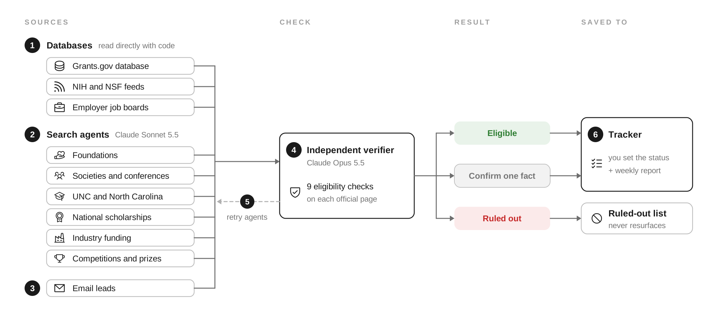

# Opportunity Scout

A system of scheduled Claude agents for a doctoral student's job and funding search. It finds grants, industry funding, scholarships, internships and jobs you are actually eligible for, then tracks what happens next in one dashboard: your applications, the people who can introduce you at each employer, and a prep brief for every meeting.



**How a weekly run works.** Numbers match the figure.
(1) Databases are read directly with code: the full daily Grants.gov database (every federal opportunity, scored with GROW's matcher), the NIH Guide and NSF funding feeds, and employer job boards.
(2) Search agents cover only sources that have no database: foundations, societies and conferences, your own university's and state's awards, national scholarships, industry funding, and competitions. Each runs at least 15 searches.
(3) Recent funding and job emails add leads.
(4) A separate verifier agent, which never sees the searchers' reasoning, opens each official page and checks nine eligibility rules: career stage, place, field, timing, award overlap, personal criteria, values, job rules, and proof on the official page.
(5) Any search agent with fewer than 4 passing finds searches again on new source types, and a fresh verifier checks the new batch.
(6) Passing items go to the tracker as Eligible, or as Confirm with the one fact to check; the user sets each item's status. Rejections go to a ruled-out list so they never come back. An editable version of the figure is in `docs/opportunity-scout-pipeline.pptx`.

## The dashboard

`tracker/opportunity-scout.html` is one page with five tabs, kept current by the scheduled agents:

| Tab | What it shows |
|---|---|
| Overview | What needs you next (meetings, application steps, close deadlines) in date order, and when each agent last ran |
| Opportunities | Verified finds, programs to watch, swept areas, and the ruled-out list |
| Applications | Each application's stage, next step, closing date, and the path to your materials folder; change the stage from the page |
| Network | A route map (you, then who can introduce you, then the person, then the employer) and the people at each employer with where each conversation stands |
| Meetings | A brief for every call or interview: who they are, what their group does, a diagram of how their work connects to yours, ranked questions you can tick off, and your notes |

Every employer name opens an employer page that gathers its applications, people, meetings and open roles. Your own choices save to the page's database, and the agents leave them alone. `tracker/README.md` has the data model.

## What's here

| Folder | What it is |
|---|---|
| `code/` | The database readers and the grant matcher. `federal_db.py` pulls the full Grants.gov database, `feeds.py` reads the NIH and NSF feeds, `jobs_feeds.py` reads employer job boards listed in `employers.json`, and `find_grants.py` plus `matcher.py` are a no-AWS copy of GROW's keyword search and scoring. |
| `agents/` | Instructions for the scheduled Claude tasks, with personal details replaced by fill-in fields: the weekly scout (search agents, verifier, retry loop, eligibility checklist), meeting prep (`meeting_prep_prompt.md`), and the application-tracking rules any email-reading agent should carry (`application_tracking.md`). |
| `tracker/` | The dashboard page, an example settings file, and the data model (`tracker/README.md`). |
| `docs/` | The pipeline figure (PNG and editable PowerPoint). |
| `network/` | After you apply: finds people at those employers you can reach through collaborators (PubMed co-author sweeps, one-employer deep dives), builds a map of the routes, and stages Outlook intro drafts. Personal data stays local. See `network/README.md`. |

## Why databases first

Search agents are slower and less complete than reading a database. On October 14, 2026, the full Grants.gov database held 83,562 opportunities. Only 1,199 were open, and 36 of those were things a doctoral student could lead. Reading the whole file takes about 20 seconds and misses nothing, where keyword search returns 25 results per term. Job boards work the same way: 29 employer boards and about 2,000 postings in about 20 seconds. Agents are kept for the sources with no open database, which is where most student funding actually lives.

## Run the code yourself

```
cd code
python federal_db.py      # full Grants.gov database, scored with GROW
python feeds.py           # NIH and NSF feeds
python jobs_feeds.py      # employer job boards
python find_grants.py     # GROW's original keyword search
```

It needs only Python, with no packages to install. Edit `code/profile.json` to change the research profile and `code/employers.json` to change the employers. See `code/README.md` for details and known limits.

## Set up the agents

1. Publish `tracker/opportunity-scout.html` as a Claude artifact with the `db` capability, and add the files in `code/` to it under `code/`. Optionally save an edited `tracker/settings.example.json` as the `settings/dashboard` document.
2. Fill in every `{{...}}` field in `agents/weekly_scout_prompt.md`, add the block in `agents/application_tracking.md` to it, and create a weekly scheduled task in Claude with that prompt.
3. Fill in `agents/meeting_prep_prompt.md` and create a scheduled task that runs it twice a day, with your email and calendar connected.
4. Optional: fill the Network tab with the tools in `network/` (co-author sweeps, an employer deep dive, or `linkedin_import.py` for a LinkedIn connections export).

The dashboard only works inside Claude, because it saves to the artifact's database.

## Credit and license

The grant matching code comes from GROW2 (Grant Research Opportunity Wizard), built by AWS with a UNC-Chapel Hill researcher: [aws-samples/sample-grants-genai-assistant](https://github.com/aws-samples/sample-grants-genai-assistant) (commit 473650f, October 2026), released under the MIT No Attribution license. The scoring math in `code/matcher.py` is unchanged; only its AWS database calls were replaced with a local profile file. The database readers, search agents, verifier loop, eligibility checklist, and tracker are new. Icons in the figure are from Phosphor Icons (MIT). Everything here is released under the MIT No Attribution license (see `LICENSE`).
