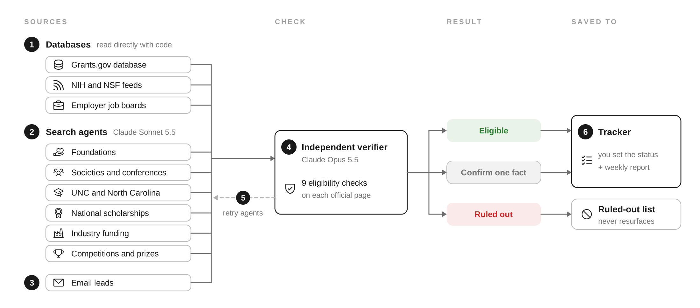

# Opportunity Scout

A weekly system that finds grants, industry funding, scholarships and awards, and jobs a doctoral student is actually eligible for, and keeps them in one tracker.



**How a weekly run works.** Numbers match the figure.
(1) Databases are read directly with code: the full daily Grants.gov database (every federal opportunity, scored with GROW's matcher), the NIH Guide and NSF funding feeds, and employer job boards.
(2) Search agents cover only sources that have no database: foundations, societies and conferences, UNC and North Carolina awards, national scholarships, industry funding, and competitions. Each runs at least 15 searches.
(3) Recent funding and job emails add leads.
(4) A separate verifier agent, which never sees the searchers' reasoning, opens each official page and checks nine eligibility rules: career stage, place, field, timing, award overlap, personal criteria, values, job rules, and proof on the official page.
(5) Any search agent with fewer than 4 passing finds searches again on new source types, and a fresh verifier checks the new batch.
(6) Passing items go to the tracker as Eligible, or as Confirm with the one fact to check; the user sets each item's status. Rejections go to a ruled-out list so they never come back. An editable version of the figure is in `docs/opportunity-scout-pipeline.pptx`.

## What's here

| Folder | What it is |
|---|---|
| `code/` | The database readers and the grant matcher. `federal_db.py` pulls the full Grants.gov database, `feeds.py` reads the NIH and NSF feeds, `jobs_feeds.py` reads employer job boards listed in `employers.json`, and `find_grants.py` plus `matcher.py` are a no-AWS copy of GROW's keyword search and scoring. |
| `agents/` | Instructions for the scheduled Claude task: search agents, the verifier, the retry loop, and the eligibility checklist, with personal details replaced by fill-in fields. |
| `tracker/` | The tracker page that stores verified opportunities, the ruled-out list, and a run log. |
| `docs/` | The pipeline figure (PNG and editable PowerPoint). |
| `network/` | After you apply: finds people at those employers you can reach through collaborators (PubMed co-author sweeps, one-employer deep dives), builds a map of the routes, and stages Outlook intro drafts. Personal data stays local. See `network/README.md`. |

## Why databases first

Search agents are slower and less complete than reading a database. On October 14, 2026, the full Grants.gov database held 83,562 opportunities. Only 1,199 were open, and 36 of those were things a doctoral student could lead. Reading the whole file takes about 20 seconds and misses nothing, where keyword search returns 25 results per term. Job boards work the same way: 29 employer boards and about 2,000 postings in about 20 seconds. Agents are kept for the sources with no open database, which is where most student funding actually lives.

## Run the code yourself

```
cd code
python federal_db.py      # full Grants.gov database, scored with GROW
python feeds.py           # NIH and NSF feeds
python jobs_feeds.py      # employer job boards
python find_grants.py     # GROW's original keyword search
```

It needs only Python, with no packages to install. Edit `code/profile.json` to change the research profile and `code/employers.json` to change the employers. See `code/README.md` for details and known limits.

## Set up the weekly agents

1. Publish `tracker/opportunity-scout.html` as a Claude artifact with the `db` capability, and add the files in `code/` to it under `code/`.
2. Fill in every `{{...}}` field in `agents/weekly_scout_prompt.md`.
3. Create a weekly scheduled task in Claude with that prompt.

The tracker page only works inside Claude, because it saves to the artifact's database.

## Credit and license

The grant matching code comes from GROW2 (Grant Research Opportunity Wizard), built by AWS with a UNC-Chapel Hill researcher: [aws-samples/sample-grants-genai-assistant](https://github.com/aws-samples/sample-grants-genai-assistant) (commit 473650f, October 2026), released under the MIT No Attribution license. The scoring math in `code/matcher.py` is unchanged; only its AWS database calls were replaced with a local profile file. The database readers, search agents, verifier loop, eligibility checklist, and tracker are new. Icons in the figure are from Phosphor Icons (MIT). Everything here is released under the MIT No Attribution license (see `LICENSE`).
